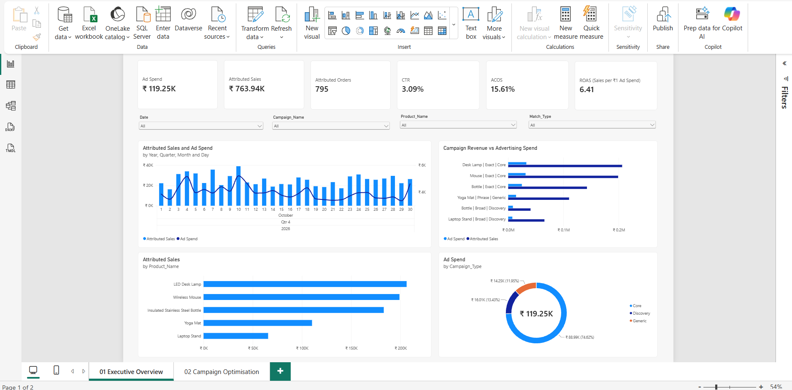
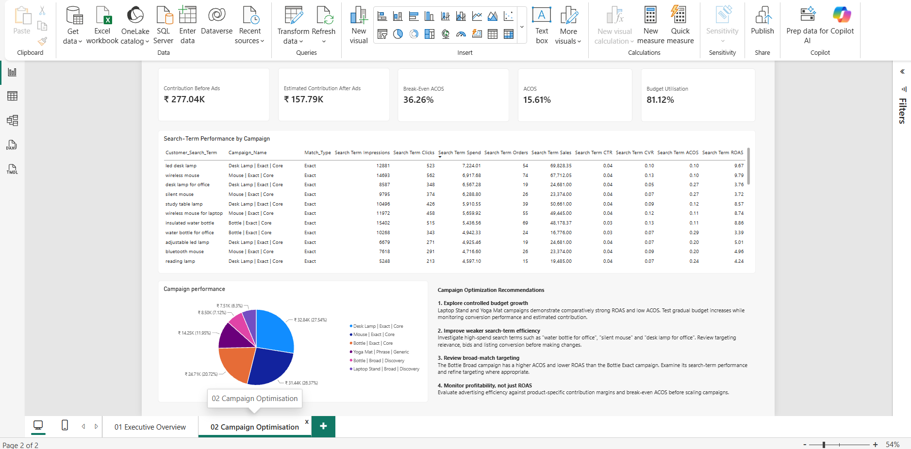
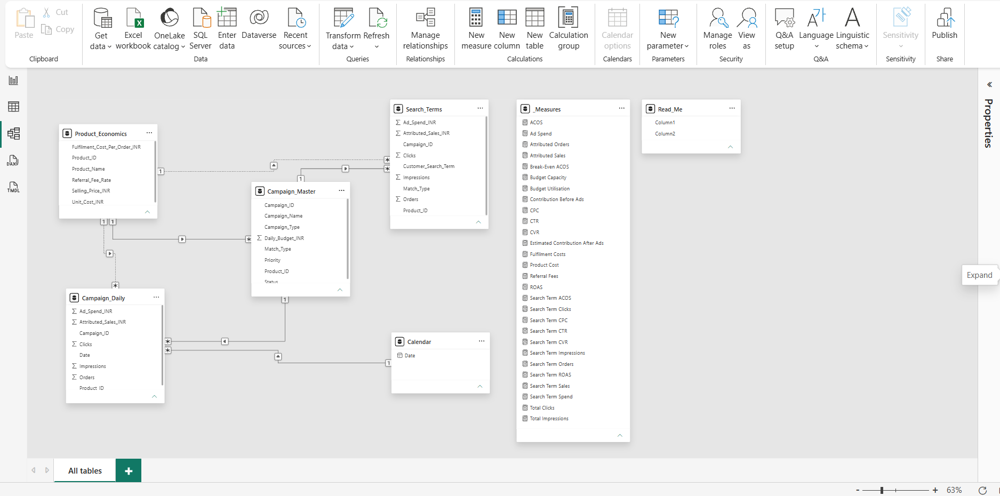

# Amazon Sponsored Products — Campaign Performance & Profitability Analytics

## Project Overview

This project analyses a simulated Amazon Sponsored Products advertising dataset using Power BI and DAX.

The objective is to evaluate advertising performance, compare campaigns, identify search-term optimisation opportunities and understand advertising profitability beyond revenue and ROAS.

The dashboard translates advertising data into practical business recommendations for campaign optimisation and budget allocation.

**Tools:** Power BI, DAX, Microsoft Excel  
**Dataset:** Simulated Amazon Sponsored Products data

---

## Dashboard Walkthrough

### Page 1 — Executive Campaign Overview

The first page provides an overview of advertising performance through:

- Total impressions, clicks, advertising spend, orders and attributed sales.
- CTR, CPC, CVR, ACOS and ROAS.
- Daily advertising spend and attributed sales trends.
- Campaign-level advertising spend and sales comparison.
- Advertising spend distribution by campaign type.
- Product-level attributed sales.
- Interactive date, campaign, product and match-type filters.

### Page 2 — Campaign Optimisation & Profitability

The second page focuses on campaign efficiency, search-term analysis and estimated profitability.

It includes:

- Estimated contribution before and after advertising.
- Break-even ACOS and budget utilisation.
- Search-term performance by campaign.
- Search-term clicks, spend, orders, sales, CTR, CVR, ACOS and ROAS.
- Campaign-level advertising spend distribution.
- Data-driven recommendations for campaign optimisation and budget allocation.

### Data Model — Power BI Model View

The data model connects the campaign, search-term, product economics and calendar tables.

**Tables used:**

- `Campaign_Master` — campaign details, types, match types and budget information.
- `Campaign_Daily` — daily campaign performance metrics.
- `Search_Terms` — customer search-term performance.
- `Product_Economics` — product costs, referral fee rates and fulfilment costs.
- `Calendar` — date dimension for time-based analysis.
- `_Measures` — centralised DAX measures used throughout the report.

The model uses campaign and product identifiers to connect the relevant tables. The Calendar table supports date-based analysis of daily campaign performance.

The two Product ID relationships from the fact tables to Product Economics are inactive in the final model. Product-level cost calculations use `LOOKUPVALUE()` in the profitability measures.

---

## Business Objectives

- Measure campaign performance using CTR, CPC, CVR, ACOS and ROAS.
- Compare campaign-level advertising efficiency.
- Identify high-performing and underperforming search terms.
- Analyse advertising spend against attributed sales.
- Estimate product contribution and break-even ACOS.
- Develop data-driven campaign optimisation recommendations.

---

## Key Metrics

| Metric | Calculation |
|---|---|
| CTR | Clicks / Impressions |
| CPC | Advertising Spend / Clicks |
| CVR | Orders / Clicks |
| ACOS | Advertising Spend / Attributed Sales |
| ROAS | Attributed Sales / Advertising Spend |
| Break-even ACOS | Contribution Before Ads / Attributed Sales |

---

## Profitability Analysis

Estimated contribution before advertising is calculated by subtracting product cost, referral fees and fulfilment costs from attributed sales.

Estimated contribution after advertising is calculated by subtracting advertising spend from contribution before advertising.

These calculations help compare actual ACOS against estimated break-even ACOS.

---

## Key Dataset Results

- Impressions: 288,372
- Clicks: 8,905
- Advertising Spend: ₹119,252.97
- Attributed Orders: 795
- Attributed Sales: ₹763,941.25
- CTR: 3.09%
- CPC: ₹13.39
- CVR: 8.93%
- ACOS: 15.61%
- ROAS: 6.41x
- Estimated Contribution After Ads: ₹157,787.09
- Estimated Break-even ACOS: 36.26%
- Budget Utilisation: 81.12%

---

## Business Recommendations

The analysis supports several optimisation opportunities:

1. Explore controlled budget growth for campaigns demonstrating stronger advertising efficiency.
2. Investigate search terms with relatively high ACOS and weaker conversion performance.
3. Review broad-match targeting where efficiency is weaker than comparable exact-match campaigns.
4. Evaluate advertising performance against estimated product contribution rather than relying solely on ROAS.

---

## Limitations and Assumptions

- All advertising campaign and search-term data is simulated.
- This project does not use a real Amazon seller or advertising account.
- Attributed sales are not independently verified sales or incremental revenue.
- Profitability is an estimate based on the product costs, referral fees and fulfilment costs provided in the dataset.
- Returns, storage fees, taxes, overhead and other potential expenses are not included.
- Search-term data is aggregated rather than daily, so it does not support genuine daily search-term trend analysis.

## Dataset Disclosure

This is an educational portfolio project using simulated data. It does not represent professional Amazon advertising account management or real campaign results.
